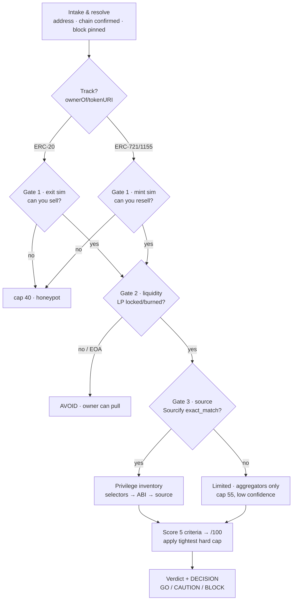

# Multichain Contract & NFT Mint Audit

One address, any chain, one defended verdict. The four questions never change:

1. **Can it be sold?** — exit simulation, not a balance read.
2. **Who owns the supply?** — holder reconstruction, deployer bag, mint rights.
3. **Is liquidity safe?** — LP locked/burned, or one signature away from gone.
4. **Does the contract have traps?** — live privilege inventory, read from source.

Three tracks share one rubric, exactly as in the BSC original: **TOKEN** (ERC-20),
**MINT** (ERC-721/1155 primary sale), **LOCK** (deposit-refund escrow). Solana has no
EVM tracks; it uses the annex in [references/solana.md](references/solana.md).

## Why this skill exists — what transfers, what does not

The BSC audit refuses non-BSC targets because its *calibration* is BSC: the Binance
Web3 audit API, PancakeSwap pins, BNB depth bands, honeypot.is chain 56. The *method*
— gates, evidence order, privilege inventory, scoring — is chain-agnostic, because
every EVM chain answers the same JSON-RPC calls. This skill keeps the method and
re-calibrates per chain:

| Piece | Transfers unchanged | Must be re-calibrated per chain |
|---|---|---|
| `scripts/rpc.py` probes | Yes — it reads `RPC_URL` from the environment | The RPC itself (see chains.md); log windows for `holders` |
| Sourcify verification | Yes — the v2 API takes any chainId | — |
| Etherscan API | Yes — v2 API, one key, `chainid=` parameter | — |
| Selector scan + privilege inventory | Yes — selectors are chain-independent | — |
| Exit simulation | Method yes | Simulator coverage: honeypot.is only covers some chains; otherwise simulate against the chain's real router/pair (Workflow 3a) |
| LP lock check | Method yes (balance at burn/locker; V3 = position NFT owner) | Locker addresses and DEX factories differ per chain (chains.md) |
| Liquidity depth bands | No | Denominated per chain in chains.md; never import the BNB bands |
| Binance Web3 audit API | **BSC only** — do not call it for other chains | On BSC, use bsc-contract-audit instead of this skill |
| Gas / fee norms | No | L2 fees are near-zero; a "high tax" finding is about the contract, not the chain |

**Non-EVM is a different toolbox, not an impossibility.** Solana's trap equivalents
are mint/freeze authority and Token-2022 extensions; see the annex.

## Scope

- Any EVM chain with a reachable RPC. Chain registry: [references/chains.md](references/chains.md).
- Solana (annex). Other non-EVM (Aptos, Sui, TON): say so and stop — no probe set here yet.
- Buyer-side due diligence on deployed contracts. Pre-deploy code review is a different task.
- **On chain 56, hand off to `bsc-contract-audit`** — it is strictly deeper there.

## Evidence rules (unchanged from the BSC original)

Trust order, highest first. Drop a level only when the level above fails, and record the drop.

1. **On-chain state** — `eth_call` / `eth_getStorageAt` / `getReserves` / `ownerOf` at a pinned block.
2. **Verified source** — Sourcify first (no key), Etherscan v2 second (`exact_match` only).
3. **Simulation** — honeypot.is where it covers the chain, else a router/pair `eth_call` simulation.
4. **Aggregators** — DexScreener (chain-agnostic), GoPlus (multi-chain, optional). Leads only;
   holder concentration comes from `rpc.py holders`, never from an aggregator.

Prohibited:

- Judging by name, logo, art, age, or follower count.
- Writing "safe" for something never probed. Write `unknown`, score partial.
- Treating a selector in bytecode as a live feature. Confirm via ABI, modifier, reachability.
- Concluding anything from proxy bytecode. Resolve the implementation first.
- **Trusting `balanceOf` as proof of value.** Phantom balances are proven in production
  (balance reads fine, any transfer reverts). A balance is a claim; a successful
  transfer/sell simulation from the holder's own address is the proof. This is the
  FAGENT rule: sellTax 100% to the creator made a real balance worth exactly zero.
- Publishing a score without the chain, the block number, and the command that produced it.

## Chain setup

```bash
cd <skill dir>
ADDR=0x...
ADDR_LC=$(printf '%s' "$ADDR" | tr 'A-Z' 'a-z')
export RPC_URL=<from references/chains.md for the target chain>
python3 scripts/rpc.py chain        # MUST print the expected chainId before anything else
BLOCK=$(python3 scripts/rpc.py block)
```

A wrong-chain RPC silently produces plausible garbage. The chain check is gate zero.

House RPC notes (this workspace): Ethereum via `https://eth.drpc.org` or
`https://rpc.mevblocker.io`; BSC archive state via the Wayfinder pool forwarder;
public RPCs cap `eth_getLogs` (often ~1000–10000 blocks) — set the window and expect
many calls for `holders`, or score concentration `partial`.

## Modes

- **Quick triage** — "is this a rug / honeypot / safe?" Gates 1–2 + holder concentration,
  verdict with any binding cap, offer the full run.
- **Full audit** — "audit / review / score this." Every step, full scored report.

## Flow



MINT-track and LOCK-track gate shapes (proceeds-before-delivery, reveal commitment,
supply bound; escrow refund/drain/timer) are identical to the BSC original — see its
SKILL.md §Flow and Workflows 3b/3c; only the chain parameters change.

## Workflow

### 0. Profile and pick the track

```bash
python3 scripts/rpc.py meta $ADDR
python3 scripts/rpc.py code $ADDR | head -c 66     # 0x = not a contract → stop
python3 scripts/rpc.py call $ADDR "ownerOf(uint256)(address)" 1      # reverts on ERC-20
python3 scripts/rpc.py call $ADDR "totalSupply()(uint256)"
python3 scripts/rpc.py call $ADDR "maxSupply()(uint256)"             # 0x/0 = uncapped or absent
```

`ownerOf(1)` succeeding, or `tokenURI(1)` returning something, means NFT → **MINT track**.
`supportsInterface` reverts on older collections — a revert there proves nothing.
Deposit-refund escrow shape (payable/token-pulling entry + timer + per-user record) →
**LOCK track**: scan for `deposit|lock|unlock|unlockTime|lockDuration`, then audit the
escrow AND the asset it hands out.

Resolve the proxy before anything else:

```bash
python3 scripts/rpc.py proxy $ADDR
IMP=$(python3 scripts/rpc.py proxy $ADDR | awk '/^implementation/{print $2}')
case "$IMP" in 0x0000000000000000000000000000000000000000) TARGET=$ADDR ;; *) TARGET=$IMP ;; esac
```

An EOA proxy admin can upgrade even after the owner renounced. Custom proxy patterns:
pull the implementation from the chain explorer, else audit the proxy and record the failure.

### 1. Verification — part of the 30

```bash
CHAINID=<target chain id>
curl -s "https://sourcify.dev/server/v2/contract/$CHAINID/$ADDR_LC" \
  | jq -r '{match,creation:.creationMatch,runtime:.runtimeMatch}'
curl -s "https://api.etherscan.io/v2/api?chainid=$CHAINID&module=contract&action=getsourcecode&address=$ADDR_LC&apikey=$ETHERSCAN_KEY" \
  | jq -r '.result[0] | {ContractName,CompilerVersion,Proxy,Implementation,SimilarMatch,src:(.SourceCode|length)}'
```

Accept `exact_match` only, on every chain. Fork spam exists everywhere; a similar match
means the ABI was borrowed while the bytecode differs — precisely in the fee, cap, and
supply constants. `runtimeMatch: exact_match` = full 8; `match` only = 4/8, hard cap 84.

With source in hand, read `transfer`, `_transfer`, `_beforeTokenTransfer`, `mint`, and
every `onlyOwner` modifier by hand. Every claim must point at a line.

Aggregator inputs that DO work cross-chain (leads, never the verdict): GoPlus
`token_security/<chainId>` where supported; DexScreener for pair discovery on any chain.
The Binance Web3 audit API is **not** one of them off BSC.

### 2. Privilege inventory — part of the 30

Identical on every EVM chain:

```bash
python3 scripts/rpc.py scan $TARGET references/selectors.md
python3 scripts/rpc.py call $ADDR "owner()(address)"          # 0x0 = renounced
python3 scripts/rpc.py call $ADDR "pendingOwner()(address)"   # Ownable2Step left hanging
python3 scripts/rpc.py call $ADDR "paused()(bool)"
python3 scripts/rpc.py call $ADDR "getRoleMemberCount(bytes32)(uint256)" \
  0x9f2df0fed2c77648de5860a4cc508cd0818c85b8b8a1ab4ceeef8d981c8956a6
```

Role hashes: `MINTER_ROLE` `0x9f2d…56a6`, `PAUSER_ROLE` `0x65d7…862a`,
`DEFAULT_ADMIN_ROLE` `0x00…00`.

`owner()` = zero inerts every `onlyOwner` function at once: full marks only if (a) no
other role is live (admin/minter/operator/proxy admin/second Ownable) and (b) no
non-owner setter shortcut exists. Zero for the criterion when: unlimited mint is live,
blacklist is live, or `transfer` sits behind `paused`/`tradingEnabled` with no permanent
open path. On the MINT track, check the bound *inside* `mint`, not just the `maxSupply`
variable's presence.

### 3a. TOKEN: exit path and fund protection — 25

First choice, where the chain is covered:

```bash
curl -s "https://api.honeypot.is/v2/IsHoneypot?address=$ADDR_LC&chainID=$CHAINID" \
  | jq '{honeypot:.honeypotResult.isHoneypot,buy:.simulationResult.buyTax,sell:.simulationResult.sellTax,flags:.flags}'
```

honeypot.is coverage is a subset of chains. Where it does not cover the chain — and
always as the cross-check, because simulators use generic routers and pair-keyed or
size-keyed taxes slip past — simulate against the **real pair**:

- Read the pair's reserves; compute the sell output for a realistic size.
- `eth_call` the router's swap (or a plain `transfer`) **from a real holder's address**
  (the user's own wallet when they already hold; else the largest non-pool holder).
  A revert, or an output implying a confiscatory tax, is the finding.
- Compare `_maxTxAmount` / `maxWallet` with the largest holder's balance — a cap below
  it traps that holder even though small wallets sell.

`isHoneypot: true`, or a sell tax far above buy tax → total capped at 40. Also check:
`transfer` not `onlyOwner`, not gated by pause / trading gate / cooldown / blacklist;
fees static or `require`-bounded; `totalSupply` not inflatable post-listing; owner
cannot drain what belongs to holders; auto-liquify cannot be fired at will.

### 3b. MINT: delivery risk and resale — 25

Chain-independent; probes identical to the BSC original (mintPrice/cost, maxSupply,
totalSupply, royaltyInfo, withdraw/sweep search, baseURI/reveal reads, mint simulation
via `eth_call` with value). The scoring questions do not change: proceeds gated on
delivery? art frozen or committed with a deadline? resale open (not paused, not
soulbound, royalty ≤10% and frozen)? refund in code, not just in docs? Simulate the
mint — a revert reason (`sale not active` / `max per wallet` / `merkle`) is the real gate.

House addition on every chain — **the spam-factory gate**: before any mint, trace the
deployer/creator and count their distinct projects (forensik-kontrak method). More
than 2 projects = factory: skip and blocklist, regardless of this audit's score.

### 3c. LOCK: deposit-refund allocation escrow — 25

Identical logic to the BSC original: refund must be permissionless and timer-gated
only; the owner must be unable to reach the pooled principal (no sweep/rescue, no
auto-forward on deposit); the timer must be immutable and the exit unpausable;
state must be zeroed before the external transfer (or a reentrancy guard present);
a live proxy admin caps at 75. A successful small test refund proves the function
works today at your size — it proves nothing about tomorrow. Held-funds check: the
contract's native + escrow-token balances against the sum of open deposits; a pool
already below the sum is critical regardless of any clean test.

### 4. Distribution and anti-manipulation — 20

Holder reconstruction is the primary path on every chain:

```bash
python3 scripts/rpc.py holders $ADDR 15          # top 15 + holder_count + % of supply
DEPLOYER=$(curl -s "https://api.etherscan.io/v2/api?chainid=$CHAINID&module=contract&action=getcontractcreation&contractaddresses=$ADDR_LC&apikey=$ETHERSCAN_KEY" \
  | jq -r '.result[0].contractCreator')
python3 scripts/rpc.py call $ADDR "balanceOf(address)(uint256)" $DEPLOYER   # deployer % of supply
```

Explorer `tokenholderlist` endpoints are paid-tier; the log reconstruction is the
source. Strip pools, lockers, burn and locked treasury before judging concentration
(a main pair holding 40–90% of supply is normal, not concentration). On the remainder:
one non-pool entity >10% is a note, >25% is serious; a deployer holding >5% unvested
is insider allocation. Vesting counts only with a real vesting contract (cliff /
duration / release, named beneficiary). MINT track: tokenId concentration instead of
balances — dev wallet >5% of minted supply is insider allocation; compare the
allowlist size against the public allocation.

Discretionary timing is manipulation surface on every chain: live `enableTrading`,
`setMaxTx`, `setBots`, `toggleSale`, unrevealed supply, surprise allowlist windows.
Fully renounced and final = full marks.

**Liquidity (TOKEN)** — find the pair from the chain's main factory (chains.md pins
the majors) or from DexScreener, then:

```bash
PAIR=$(python3 scripts/rpc.py call $FACTORY "getPair(address,address)(address)" $ADDR $WNATIVE)
python3 scripts/rpc.py call $PAIR "getReserves()(uint112,uint112,uint32)"
python3 scripts/rpc.py call $PAIR "balanceOf(address)(uint256)" 0x000000000000000000000000000000000000dEaD
python3 scripts/rpc.py call $PAIR "balanceOf(address)(uint256)" $LOCKER   # per chains.md
```

Locked = burned to `0x…dEaD` or sitting in a recognised locker **now** (verify the
balance, not a tag or a past transaction). V3 liquidity is a position NFT — read
`ownerOf(tokenId)` on the chain's position manager; an unlocked position is
withdrawable by whoever holds the NFT. **Depth bands are per chain** (chains.md):
the portable default is thin < US$10k · fair US$10k–250k · deep > US$250k of
realisable side liquidity; on BSC use the original BNB bands via bsc-contract-audit.

**Liquidity equivalent (MINT)** — live listings, bids, and sales on the chain's actual
marketplaces (they differ per chain: OpenSea/Blur on Ethereum, Element on BSC,
Tensor/Magic Eden on Solana). Zero secondary listings = no observable exit.

Wash signals, all chains: `vol24 / liquidity > 5`; few unique senders against a high
tx count; identical repeat amounts; team wallets minting and "selling" to each other.

### 5. Transparency — 15

Identical method everywhere: pull every site claim (supply, price, fees, "renounced",
"locked", "audited", team, reveal date, art provenance) and diff each against code.
Match = points; mismatch = zero plus a critical finding. An IPFS CID in `baseURI` is
frozen art; a team-served `https://…/json/<id>` is not. An audit counts only if the
report opens, comes from a checkable firm, and points at **this** address or commit.
Anonymous team costs points and must be named.

### 6. Market viability — 10

```bash
curl -s "https://api.dexscreener.com/latest/dex/tokens/$ADDR_LC" \
  | jq '.pairs[] | {chainId,dexId,pairAddress,liq:.liquidity.usd,vol24:.volume.h24,txns:.txns.h24,created:.pairCreatedAt,chg:.priceChange}'
```

Confirm the pair's `chainId` matches the target chain — DexScreener returns pairs for
the same address on several chains, and only one of them is yours. MINT: floor against
mint price, bid depth, 7-day sales, unique holders; mint price above 5× the current
floor caps at 70. A pair or first mint under 24h is short history: say it, lower
confidence, do not auto-zero.

## Scoring

Same rubric as the BSC original — Security 30 · Investor protection 25 ·
Anti-manipulation 20 · Transparency 15 · Market viability 10 (sub-points unchanged;
see bsc-contract-audit §Scoring). Verdict: **85–100 PASS** · **70–84 PASS WITH
NOTES** · **55–69 REVIEW** · **<55 AVOID**.

Hard caps (tightest wins, never summed) — all chain-independent except the LP cap,
which here is denominated in the portable USD band:

| Condition | Cap |
|---|---|
| Transfer blocked / honeypot (either track) | 40 |
| Soulbound, or pause-only transfer on a mint | 45 |
| Sell tax >25% or >3× buy tax | 45 |
| No verified source at all | 55 |
| Uncapped supply with live team mint | 60 |
| `baseURI` mutable after reveal, or no reveal commitment | 60 |
| Proceeds withdrawable before any delivery, no refund | 65 |
| Mint price >5× floor | 70 |
| Unrevealed with no enforced deadline | 70 |
| Deployer holds >20% of supply or minted tokenIds, unvested | 65 |
| LP unlocked and depth in the thin band (token) | 55 |
| Proxy with EOA admin and live owner | 75 |
| Escrow: owner can drain the pooled principal, or deposits auto-forward to an EOA | 40 |
| Escrow: no user-callable principal withdraw | 40 |
| Escrow: refund/withdraw pausable, or unlock time mutable by owner | 55 |
| Escrow: external transfer before the user record is zeroed (reentrancy) | 45 |
| Source only `match` | 84 |

## Decision line and house rules

End every audit with the machine-readable line, mapped from verdict + binding cap:

```
DECISION: GO | CAUTION | BLOCK — <one-line reason>
```

| Decision | Condition | What happens next |
|----------|-----------|-------------------|
| **BLOCK** | score < 55, or any honeypot / transfer-blocked / soulbound cap | refuse the buy/swap/mint |
| **CAUTION** | score 55–84 | proceed only after the user acknowledges the ranked risks |
| **GO** | score ≥ 85, no binding cap | may proceed — still not financial advice |

House rules that bind on top of any GO, on every chain:

- A GO never executes by itself. Any buy/mint still needs the user's confirmation of
  the exact nominal (amount in the token's own units + USD + IDR at a quoted rate),
  per the standing nominal-confirmation rule; the crowd-scan auto-execute guardrails
  are their own separate regime and do not inherit this skill's GO.
- Price encoding follows `onchain-price-accuracy`: verify decimals on-chain, BigInt
  conversion, decode-before-sign, exact match or stop.
- If this audit and any fast API check disagree, the stricter result wins.

## Solana annex (summary)

No EVM gates apply. The equivalent probe set — full recipes in
[references/solana.md](references/solana.md):

- **Trap equivalents:** `mintAuthority` (null = supply frozen), `freezeAuthority`
  (a live one means any holder can be frozen — the $BROK finding), Metaplex metadata
  `isMutable` + `updateAuthority`, and Token-2022 extensions (transfer fee, permanent
  delegate, non-transferable, default frozen state).
- **Supply ownership:** `getTokenLargestAccounts` concentration + who the authorities are.
- **Liquidity:** pairs via DexScreener (Raydium / Meteora / Orca); LP mint burned or
  locked — read the LP mint's supply and the pool vaults, not a badge.
- **Exit:** a sell route existing on a live pair with real depth; a token can be
  tradeable and still be a trap if freeze authority is live.
- Verdict format and DECISION line are the same; score only the criteria the annex
  can evidence, and mark the rest `unknown`.

## Report format

```markdown
# Audit <SYMBOL> — <CHAIN NAME> <chainId> <ADDR> — TOKEN|MINT|LOCK (or SOLANA)
Block <n> · <ISO8601> · source: exact_match (Sourcify) · RPC <host>

Score: 58/100 — REVIEW   (binding cap: proceeds withdrawable, baseURI mutable)
DECISION: CAUTION — resale works, but proceeds drain before delivery; acknowledge before minting

| Criterion | Score | Basis |
|---|---|---|
| Security | 22/30 | E1, E2 |
| Investor protection | 12/25 | E3, E4 |
| Anti-manipulation | 11/20 | E5 |
| Transparency | 8/15 | E6 |
| Market viability | 5/10 | E7 |

## Critical
1. <finding> — evidence E<n>, impact.

## Moderate
## Unproven
## Recommendations
## Evidence log
E1 <command/URL> → <trimmed output>
```

Rules: short sentences; every score cites evidence; keep "absent" separate from
"unknown"; quote claim and code verbatim when they diverge; close with the one line
that would change the verdict. Always end with `Reference only, not investment advice.`

## Common misreads (all chains)

- **`owner()` reverts** — the function may not exist; that is not a renounce. Only a
  successful call returning zero is.
- **Selector in bytecode** — may be library, dead code, or an implementation the proxy
  never delegates to. Confirm via ABI and modifier.
- **Tax 0 in a generic simulation** — pair-keyed or size-keyed tax slips past. Retest
  against the real pair, from a real holder.
- **Right address, wrong chain** — the same 0x address can host different contracts on
  different chains. Pin chainId first; a BSC verdict says nothing about Base.
- **LP "in a locker"** — confirm the balance sits there now. No proof of lock = not locked.
- **Sold out = demand** — check whether team wallets minted the last chunk.
- **Revealed = delivered** — mutable `baseURI` can still re-skin the collection.
- **`balanceOf` = value** — phantom balances exist (reads fine, transfers revert).
  Simulate the transfer; the simulation is the fact.

## Before closing

- [ ] Chain confirmed (`rpc.py chain` == target chainId) and block recorded; all probes read the same state.
- [ ] Track chosen on evidence (`ownerOf` / `tokenURI`), not on the site's framing.
- [ ] Address matches the user's, character for character; `eth_getCode` is not `0x`.
- [ ] Proxy resolved; the implementation is what got audited.
- [ ] Exit simulated against the real pair, from a real holder address.
- [ ] LP lock proven by a live balance read at the locker/burn address.
- [ ] Every sub-point has evidence or is `unknown`; hard caps applied on the tightest value.
- [ ] Claim-vs-code mismatches quoted verbatim.
- [ ] No "safe" or "certain" without a citation.
